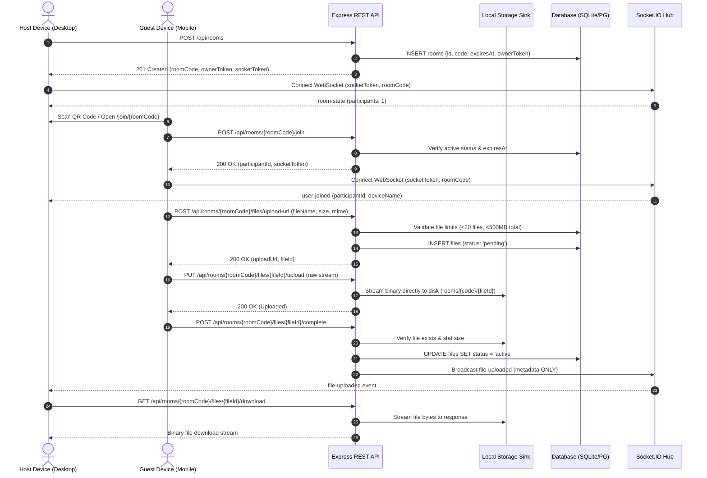
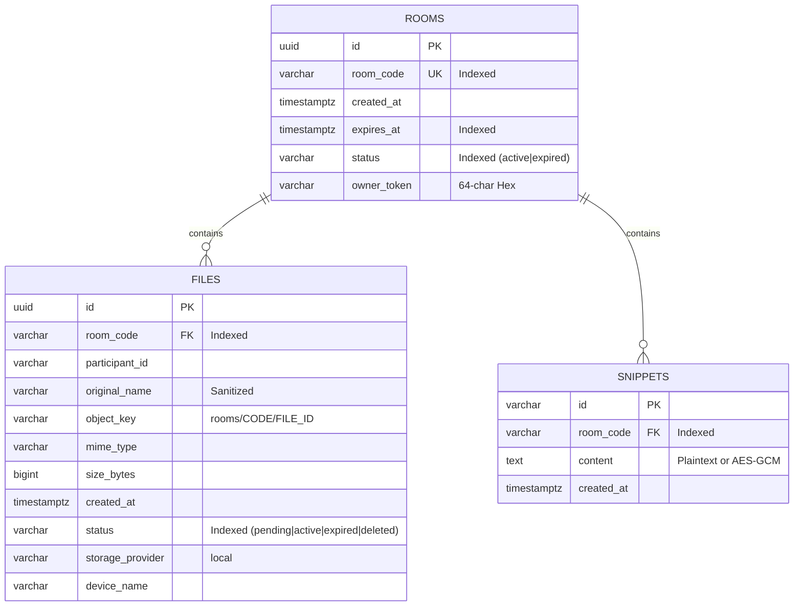

# DropX

> **Ephemeral, zero-knowledge cross-device file and clipboard synchronization platform engineered for high-speed local data transfers with zero permanent cloud persistence.**

---

## Executive Summary

**DropX** is an ephemeral data transfer system that enables instantaneous file streaming and clipboard synchronization across heterogeneous environments (iOS, Android, macOS, Windows, Linux) without requiring user accounts, authentication setups, third-party software installations, or persistent database storage. 

Devices pair in seconds using dynamic QR codes or cryptographically random 6-character room codes. File transfers stream directly into temporary memory-bounded local storage sinks with client-side AES-256-GCM Zero-Knowledge end-to-end encryption. When a session expires (default 120 minutes) or is explicitly terminated by the session creator, all associated files, database records, and active WebSocket channels are permanently wiped from the server.

```
                  +----------------------------------------------+
                  |               Client Devices                 |
                  |     (Mobile Safari, Chrome, Firefox, Edge)   |
                  +----------------------+-----------------------+
                                         |
                   +---------------------+---------------------+
                   |                                           |
             HTTP / REST API                             Socket.IO Stream
      (Auth, Upload URL, Complete, DL)            (Presence, Room State, Signals)
                   |                                           |
                   v                                           v
  +-------------------------------------------------------------------------+
  |                   Node.js / Express Application Server                  |
  |                                                                         |
  |   +-----------------------+  +-------------------+  +---------------+   |
  |   | Helmet / CORS Guard   |  | Multi-Tier Redis  |  | Zod Parameter |   |
  |   | (Security Headers)    |  | Rate Limiters     |  | Validation    |   |
  |   +-----------------------+  +-------------------+  +---------------+   |
  |                                                                         |
  |   +-----------------------------------------------------------------+   |
  |   |   Socket.IO Server Engine with Redis Pub/Sub Cluster Adapter    |   |
  |   +-----------------------------------------------------------------+   |
  +--------------------+----------------------------------+-----------------+
                       |                                  |
                       v                                  v
      +--------------------------------+  +---------------------------------+
      | Local Ephemeral Storage Engine |  | Database Persistence Layer      |
      | - Direct binary stream pipes   |  | - SQLite (Local Development)    |
      | - 100MB per-file hard cap      |  | - PostgreSQL (Production Pool)  |
      | - Unlink on expiry/teardown    |  | - Indexed Room & File State     |
      +----------------▲---------------+  +---------------▲-----------------+
                       |                                  |
                       +----------------+-----------------+
                                        |
                       +----------------+-----------------+
                       | Background Sweeper Worker        |
                       | - Redis-locked periodic cleaner  |
                       | - Room TTL hard eviction         |
                       | - Orphaned pending file cleanup  |
                       +----------------------------------+
```

---

## The Problem & Engineering Motivation

Modern cross-device local file sharing suffers from proprietary fragmentation, privacy invasive cloud logging, and network bloat:

1. **Ecosystem Fragmentation**: Apple AirDrop and Android Quick Share do not interoperate natively. Moving raw photos or large binaries between an iPhone and a Linux workstation requires awkward workarounds (emailing yourself, messaging apps, or cloud storage).
2. **Persistence & Privacy Violations**: Cloud storage providers (Google Drive, Dropbox, OneDrive) require authenticated user accounts, track upload histories, and leave permanent data trails on remote servers.
3. **Quality Degradation & Compression**: Messaging platforms (WhatsApp, Telegram, Slack) compress images and videos, mangle EXIF data, enforce arbitrary bandwidth throttles, and pollute chat histories.
4. **Memory Exhaustion in Traditional Upload Servers**: Standard web upload handlers buffer entire multipart payloads in memory (V8 heap). Concurrent 100MB uploads quickly exhaust server RAM and trigger garbage collector thrashing.

### The DropX Solution
DropX eliminates these friction points by combining **ephemeral room tokens**, **browser-native Web Crypto encryption**, **memory-safe streaming binary pipelines**, and **real-time WebSocket signaling** into a zero-login progressive web application.

---

## Key Features

- **Instant Zero-Config Pairing**: Pair any smartphone, tablet, or desktop in less than 3 seconds by scanning an SVG QR code or entering a 6-character room code.
- **Client-Side Zero-Knowledge Encryption (E2EE)**: Sensitive payloads and text snippets can be encrypted directly in the browser via AES-256-GCM using keys derived from the room code with Web Crypto API (`window.crypto.subtle`). The server operates as an untrusted blind broker.
- **Memory-Bound Streaming I/O**: Direct stream piping (`express.raw`) ensures the Node.js process buffers only small stream chunks (~64KB) rather than holding 100MB payloads in the V8 heap.
- **Real-Time Live Clipboard**: Bi-directional text synchronization synchronizes code snippets, links, and passwords across all paired devices via WebSocket events.
- **Dynamic Device Presence Tracking**: Automatically detects browser family and operating system (e.g., *Safari on iPhone*, *Chrome on Windows PC*) and displays connected peers in real time.
- **Deterministic Ephemeral Lifecycle**: Active rooms self-destruct upon expiration (default 2 hours) or host termination. Stale pending uploads older than 30 minutes are evicted by a scheduled sweeper.
- **Multi-Node Cluster Ready**: Socket.IO signaling leverages `@socket.io/redis-adapter` and Redis-backed rate limiting, allowing stateless horizontal scaling across multiple container instances.
- **PWA & Mobile Ready**: Full Progressive Web App manifest with offline shell caching (`sw.js`) and Web Share Target API integration.

---

## Technology Stack

### Frontend Architecture
| Technology | Version | Purpose in DropX |
| :--- | :--- | :--- |
| **React** | `18.3.1` | Declarative component UI rendering and reactive application state machine |
| **TypeScript** | `5.2.2` | Compile-time type safety across API contracts and socket payload definitions |
| **Vite** | `5.3.1` | Ultra-fast HMR development server and optimized ESM production bundler |
| **Tailwind CSS** | `3.4.4` | Low-latency utility styling featuring OLED black theme, animations, and glassmorphism |
| **Socket.IO Client** | `4.7.5` | Real-time bi-directional WebSocket connection, automatic reconnects, and presence sync |
| **Lucide React** | `0.395.0` | Accessible, tree-shakeable SVG icons for device indicators and file types |
| **qrcode.react** | `3.1.0` | Client-side vector SVG QR code generation for instant camera scanning |

### Backend Architecture
| Technology | Version | Purpose in DropX |
| :--- | :--- | :--- |
| **Node.js (ESM)** | `20+` / `24+` | Non-blocking asynchronous JavaScript runtime using native ES Modules |
| **Express.js** | `4.19.2` | REST API routing, streaming body parsers, and middleware pipeline |
| **Socket.IO** | `4.7.5` | WebSocket engine managing room channels, socket authentication, and live broadcasts |
| **@socket.io/redis-adapter** | `8.3.0` | Distributed Pub/Sub adapter broadcasting socket events across scaled backend nodes |
| **ioredis** | `5.4.1` | High-performance Redis client for distributed locking, rate limiting, and presence |
| **PostgreSQL (`pg`)** | `8.12.0` | Production connection pool (`pg.Pool`) managing rooms, files, and snippet metadata |
| **SQLite (`sqlite3`)** | `5.1.7` | Zero-configuration file database for local development and standalone testing |
| **Zod** | `3.23.8` | Strict environment variable parsing and input schema validation |
| **Helmet** | `7.1.0` | Security headers (nosniff, X-Frame-Options, cross-origin resource policy) |
| **express-rate-limit** | `7.3.1` | Multi-tier rate limiting with Redis store fallback |
| **Pino & Pino-Http** | `9.2.0` / `10.1.0` | High-throughput structured JSON logger with automatic header/token redacting |

---

## System Architecture

### Request & File Transfer Lifecycle

The DropX file transfer protocol decouples metadata negotiation from binary payload ingestion:



---

## Core Engineering Highlights

### 1. Memory-Bound Streaming Binary Pipeline
Standard multipart parsing libraries (such as unconfigured Multer or Busboy) buffer incoming data into V8 heap buffers. When multiple users upload 100MB files simultaneously, memory usage spikes, triggering garbage collection stops and potential `ERR_WORKER_OUT_OF_MEMORY` process crashes.

DropX implements raw streaming via `express.raw({ type: '*/*', limit: '100mb' })`:
- Payloads stream directly through the HTTP parser into disk storage sinks without accumulating full files in memory.
- Peak heap utilization remains bounded at the socket buffer chunk level (~64KB per active transfer).
- Filenames and MIME headers are registered in the database during the pre-signed URL negotiation step and verified upon completion.

### 2. Zero-Knowledge Browser-Native E2EE (AES-256-GCM)
In addition to standard transport encryption (TLS/HTTPS), DropX includes client-side cryptographic isolation:
- The client derives a deterministic 256-bit AES-GCM key from the room code using `SHA-256` with a high-entropy salt via the Web Crypto API (`window.crypto.subtle`).
- Files and text snippets are encrypted in the browser prior to HTTP transmission, prepending a random 12-byte initialization vector (`IV`) to the ciphertext blob.
- The backend server and storage disks hold only encrypted ciphertext. Downloaders decrypt the payload in their local browser sandbox using the room key.

### 3. Crockford-Style Ambiguity-Free Room Code Generation
DropX room codes use a 32-character alphabet:
```javascript
const ROOM_CODE_CHARSET = '23456789ABCDEFGHJKLMNPQRSTUVWXYZ';
```
Characters `0` (Zero), `O` (Capital O), `1` (One), and `I` (Capital I) are completely omitted. This eliminates transcription errors when users read codes across mobile and monitor screens.

### 4. Distributed State Machine & Redis Locking
In multi-node deployments, running background eviction loops on every container leads to database race conditions and file lock contention. DropX uses Redis atomic distributed locks (`NX`, `PX`):
```javascript
const res = await redis.set('lock:room-cleanup', instanceId, 'NX', 'PX', 55000);
if (res === 'OK') {
  await roomService.cleanupExpiredRooms();
  await fileService.cleanupExpiredFiles();
}
```
Only the single leader container acquires the lock and coordinates cleanup, while other instances safely skip the cycle.

---

## Database Architecture

DropX uses a repository pattern with dynamic driver abstraction supporting **PostgreSQL** in production and **SQLite** for development:



---

## Security & Reliability Hardening

| Threat Domain | Mitigation Strategy | Implementation Evidence |
| :--- | :--- | :--- |
| **Path Traversal** | Sanitization and flat object key structure | `path.basename(input).replace(/[<>"']/g, '_')` in `fileService.js` |
| **Heap Memory Exhaustion** | 100MB streaming upload cap & 100KB JSON limit | `express.raw({ limit: 104857600 })` and `express.json({ limit: '100kb' })` in `app.js` |
| **Timing Attacks** | Constant-time HMAC & token comparison | `crypto.timingSafeEqual` in `crypto.js` and `token.js` |
| **Insecure Direct Object Reference (IDOR)** | Scoped token validation | Participant socket tokens must match `params.roomCode`; non-owners cannot delete peer files |
| **Room Flooding / DoS** | Multi-tier rate limiting | RedisStore rate limiter on `/rooms` (20 req/15m) and `/join` (30 req/15m) |
| **Zombie Storage Leakage** | Automated dual-tier garbage collection | Cron sweeper unlinks expired room files and pending uploads older than 30m |
| **Secret & Token Leaks** | Log field redaction | Pino logger redacts `authorization`, `cookie`, `password`, `token`, `presignedUrl` |

---

## API Reference

### REST Endpoints

| Method | Endpoint | Auth Required | Description |
| :--- | :--- | :--- | :--- |
| `POST` | `/api/rooms` | No | Creates a new ephemeral room with 6-char code and owner token |
| `GET` | `/api/rooms/:roomCode` | No | Retrieves room status and expiry (does not expose owner token) |
| `POST` | `/api/rooms/:roomCode/join` | No | Validates room code and issues a participant socket token |
| `GET` | `/api/rooms/:roomCode/presence`| Bearer Token | Returns real-time active device counts and participant identities |
| `DELETE` | `/api/rooms/:roomCode` | Owner Token | Destroys room immediately, deleting all physical files and snippets |
| `POST` | `/api/rooms/:roomCode/files/upload-url` | Bearer Token | Validates quota and issues upload slot |
| `PUT` | `/api/rooms/:roomCode/files/:fileId/upload` | No (Slot ID) | Streams raw binary payload into local storage sink |
| `POST` | `/api/rooms/:roomCode/files/:fileId/complete` | Bearer Token | Verifies disk size and broadcasts `file-uploaded` |
| `GET` | `/api/rooms/:roomCode/files` | Bearer Token | Returns metadata list of active shared files in room |
| `GET` | `/api/rooms/:roomCode/files/:fileId/download-url`| Bearer Token | Generates download link for file |
| `GET` | `/api/rooms/:roomCode/files/:fileId/download` | No | Streams file binary content to client browser |
| `DELETE` | `/api/rooms/:roomCode/files/:fileId` | Bearer Token | Unlinks physical file and broadcasts `file-deleted` |
| `GET` | `/api/rooms/:roomCode/snippets` | Bearer Token | Returns live clipboard snippets list |
| `POST` | `/api/rooms/:roomCode/snippets` | Bearer Token | Creates text snippet and broadcasts `snippet:created` |
| `DELETE` | `/api/rooms/:roomCode/snippets/:id` | Bearer Token | Deletes text snippet and broadcasts `snippet:deleted` |
| `GET` | `/api/health` | No | Liveness probe returning status, uptime, and timestamp |
| `GET` | `/api/ready` | No | Readiness probe verifying storage and database subsystems |

### WebSocket Protocol (Socket.IO)

| Event Name | Direction | Payload Structure | Description |
| :--- | :--- | :--- | :--- |
| `connection` | Client ➔ Server | `auth: { token, roomCode, deviceName }` | Handshake validating signed socket token against room state |
| `room-state` | Server ➔ Client | `{ roomCode, participantCount, participants, expiresAt }` | Dispatched to client immediately on connection |
| `user-joined` | Server ➔ Client | `{ participantId, role, deviceName, participantCount }` | Dispatched to room peers when a device connects |
| `user-left` | Server ➔ Client | `{ participantId, participantCount }` | Dispatched to room peers when a device disconnects |
| `file-uploaded` | Server ➔ Client | `{ id, originalName, mimeType, sizeBytes, deviceName }` | Dispatched when upload verification completes |
| `file-deleted` | Server ➔ Client | `{ fileId, roomCode }` | Dispatched when a file is unlinked |
| `snippet:created` | Server ➔ Client | `{ id, roomCode, content, createdAt }` | Dispatched when a text snippet is shared |
| `snippet:deleted` | Server ➔ Client | `{ id, roomCode }` | Dispatched when a text snippet is removed |
| `room-expired` | Server ➔ Client | `{ roomCode, message }` | Dispatched on room timeout or host deletion |

---

## Configuration Reference

Key runtime parameters configurable via `.env`:

| Variable | Type | Default | Description |
| :--- | :--- | :--- | :--- |
| `PORT` | Number | `3000` | Port for Express HTTP & WebSocket server |
| `NODE_ENV` | String | `development` | Environment mode (`development`, `production`, `test`) |
| `ALLOWED_ORIGINS` | String | `http://localhost:5173,...` | Comma-separated CORS allowed origins or `*` |
| `DATABASE_URL` | String | `undefined` | PostgreSQL connection string (defaults to SQLite if unset) |
| `DB_POOL_MAX` | Number | `10` | Maximum connections in PostgreSQL pool |
| `STORAGE_PROVIDER` | String | `local` | Storage driver (`local`) |
| `LOCAL_STORAGE_DIR` | String | `./data/uploads` | Local filesystem directory for temporary files |
| `MAX_FILE_SIZE_MB` | Number | `100` | Hard cap on individual upload payload (in MB) |
| `MAX_FILES_PER_ROOM` | Number | `20` | Maximum simultaneous active files in a room |
| `MAX_ROOM_STORAGE_BYTES` | Number | `524288000` | Aggregate storage quota per room (500MB) |
| `ROOM_TTL_MINUTES` | Number | `120` | Room session duration before auto-eviction (in minutes) |
| `PENDING_FILE_TTL_MINUTES` | Number | `30` | Maximum lifetime for uncompleted uploads |
| `ROOM_CLEANUP_INTERVAL_MS` | Number | `60000` | Frequency of background cleanup sweeper |
| `REDIS_URL` | String | `undefined` | Redis connection URL for Pub/Sub & rate limiting |
| `REDIS_HOST` | String | `undefined` | Redis host (if not using `REDIS_URL`) |
| `REDIS_PORT` | Number | `6379` | Redis port |
| `SOCKET_TOKEN_SECRET` | String | `dropx-stable-...` | Secret key used for signing participant HMAC tokens |
| `TRUST_PROXY_HOPS` | Number | `1` | Number of upstream reverse proxy hops to trust |

---

## Local Development Setup

### Prerequisites
- **Node.js**: `>= 20.0.0`
- **npm**: `>= 9.0.0`

### 1. Clone & Setup Backend
```bash
git clone https://github.com/tanmay9783/dropx.git
cd dropx/backend
npm install
npm run dev
```
- The backend initializes an automated SQLite database in `./data/dropx.sqlite`.
- Server runs on `http://localhost:3000`.
- Verify liveness: `curl http://localhost:3000/api/health`.

### 2. Setup Frontend Application
```bash
cd ../frontend
npm install
npm run dev
```
- Frontend starts on `http://localhost:5173`.
- Open `http://localhost:5173` on desktop or visit from your mobile browser on the same Wi-Fi network.

---

## Production Deployment

### Docker & Docker Compose
DropX includes an optimized multi-stage `Dockerfile` and `docker-compose.yml`:

```bash
docker-compose up --build -d
```
The Docker container builds the React frontend static assets, bundles them into the production image, and serves both REST APIs and the frontend static shell from the Node.js server on port `3000`.

### Production Cloud Deployment
- **Backend API**: Hosted on Render (`https://dropx-6pky.onrender.com`).
- **Frontend SPA**: Deployed to Vercel with single-page app rewrites configured in `frontend/vercel.json`.
- **Health Checks & Keep-Alive**: Configured via GitHub Actions cron in `.github/workflows/keepalive.yml`.

---

## Test Automation

DropX uses Node.js's native test runner (`node:test`) and Supertest for fast, dependency-light testing:

```bash
cd backend
npm test
```

### Verified Test Suites:
1. `room.test.js`: Validates room generation, 6-character charset, lazy expiration checks, and owner token isolation.
2. `file.test.js`: Validates raw stream upload, disk storage verification, socket metadata broadcasting, and file deletion.
3. `localStorage.test.js`: Tests directory creation, binary PUT streaming, and stat verification.
4. `security.test.js`: Asserts IDOR rejection across rooms, XSS filename sanitization, Helmet headers, and CORS origin enforcement.
5. `socket.test.js`: Tests WebSocket token handshake, presence synchronization, and disconnect broadcasting.
6. `lifecycle.test.js`: Enforces room storage quota limits, maximum file count caps, and stale upload cleanup.

---

## Contributing & License

Contributions are welcome. Please ensure that:
1. All changes maintain strict Zero-Knowledge and ephemeral storage guarantees.
2. Code follows modular ESM patterns and passes existing test suites (`npm test`).
3. Sensitive data or credentials are never logged or committed.

Distributed under the MIT License. Developed with care by [Tanmay Agrawal](https://github.com/tanmay9783).
